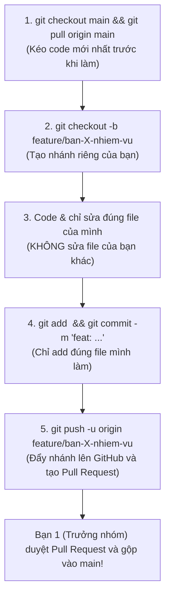

# 🦉 HƯỚNG DẪN BÀI TẬP LỚN & PHÂN CÔNG NHÓM: DỰ ÁN MATHDUO AI
> **Môn học**: Công nghệ phần mềm / Lập trình Web  
> **Dự án**: MathDuo AI – Nền tảng luyện tập Toán Tiểu học với Gia sư Trí tuệ Nhân tạo  
> **Mục tiêu nhóm**: Phân chia 7 phần việc độc lập hoàn toàn (1–2 file/người), **cam kết 0% xung đột mã nguồn (zero Git conflict)**.

---

## 📋 1. BẢNG PHÂN CÔNG TỔNG QUAN (7 THÀNH VIÊN)

| Thành viên | Tên vai trò | File phụ trách | Nhiệm vụ chính |
|---|---|---|---|
| **Bạn 1** | Trưởng nhóm & Giao diện Nền tảng | `src/app/globals.css`<br>`src/components/ThemeToggle.tsx` | Quản lý theme Sáng/Tối, background quầng sáng ambient glow |
| **Bạn 2** | Hiển thị Công thức Toán | `src/components/LatexText.tsx` | Dùng KaTeX render công thức $...$ (phân số, phép tính) an toàn |
| **Bạn 3** | Thẻ Bài tập Trắc nghiệm | `src/components/QuizCard.tsx` | Dựng card 4 lựa chọn A/B/C/D, logic nộp bài đúng viền xanh, sai viền đỏ |
| **Bạn 4** | Ngân hàng Đề bài Tiểu học | `src/data/mockQuiz.ts` | Soạn 4–5 câu hỏi Toán vui (chia kẹo 🍬, pizza 🍕, chu vi vườn 🌳) |
| **Bạn 5** | Backend & Gemini AI | `src/app/api/chat/route.ts`<br>`.env.local` | Viết API kết nối Google Gemini (`gemini-2.5-flash`), persona Gia sư Cú Vàng |
| **Bạn 6** | Khung Chat Gia sư AI | `src/components/ExplainChatDrawer.tsx` | Drawer trượt từ phải, ô chat sạch đẹp không scrollbar, nút chèn icon nhanh |
| **Bạn 7** | Kiểm thử QA & Triển khai Deploy | `package.json`<br>Kiểm tra toàn bộ web | Rà soát lỗi build (`npm run build`), chạy Cloudflare Tunnel lấy link nộp bài |

---

## 🛠️ 2. CHI TIẾT CÔNG VIỆC TỪNG BẠN & CÁCH TỰ TEST ĐỘC LẬP

### 👤 BẠN 1: Trưởng nhóm — Nền móng Giao diện & Đổi Theme Sáng/Tối
- **File làm việc**: 
  - `src/app/globals.css`
  - `src/components/ThemeToggle.tsx`
- **Việc cụ thể**:
  1. Trong `globals.css`: Viết class `.ambient-grid-background` tạo nền có lưới chấm mờ kết hợp quầng sáng tím/ngọc bích tạo chiều sâu cho cả 2 theme.
  2. Trong `ThemeToggle.tsx`: Viết nút bấm đổi giao diện với icon Mặt trời / Mặt trăng (`lucide-react`). Khi bấm thì thêm/gỡ class `dark` trên thẻ `<html>` và lưu trạng thái vào `localStorage`.
- **Cách tự test trên máy mình**:
  - Chạy `npm run dev` và mở `http://localhost:3000`.
  - Nhấp vào nút icon Mặt trời/Mặt trăng ở góc trên bên phải.
  - **Kết quả đạt**: Màu nền chuyển đổi mượt mà giữa tone xám sáng thanh lịch và tone tối sâu sắc nét, không bị giật trang.

---

### 👤 BẠN 2: Chuyên viên Hiển thị Công thức Toán KaTeX
- **File làm việc**: 
  - `src/components/LatexText.tsx`
- **Việc cụ thể**:
  1. Viết component nhận prop chuỗi chữ `text: string`.
  2. Dùng biểu thức Regex tách các đoạn công thức nằm trong dấu `$kí_hiệu$` hoặc `$$công_thức$$`.
  3. Sử dụng thư viện `katex.renderToString()` để chuyển đổi ký hiệu LaTeX thành HTML hiển thị phân số ($\frac{1}{2}$), phép nhân ($\times$), lũy thừa ($x^2$).
  4. Đảm bảo chữ xung quanh giữ nguyên font bình thường, công thức kế thừa màu chữ của nút bấm (`color: inherit`).
- **Cách tự test trên máy mình**:
  - Đưa thử đoạn text: `<LatexText text="Bạn có $1/2$ quả cam và $3 \times 4$ viên kẹo" />`.
  - **Kết quả đạt**: Phân số 1/2 và dấu nhân hiển thị chuẩn toán học, không bị lỗi font hay in đè chữ.

---

### 👤 BẠN 3: Kỹ sư Giao diện Thẻ Bài tập Trắc nghiệm (QuizCard)
- **File làm việc**: 
  - `src/components/QuizCard.tsx`
- **Việc cụ thể**:
  1. Thiết kế Card làm bài bo góc tròn phong cách Duolingo, cỡ chữ to rõ phù hợp học sinh tiểu học.
  2. Hiển thị 4 nút bấm chọn đáp án A, B, C, D.
  3. Xử lý trạng thái:
     - **Chưa nộp bài**: Cho phép học sinh click chọn 1 đáp án, nút "Explain" ở chân trang **hoàn toàn ẩn đi**.
     - **Sau khi nộp bài**:
       + Chọn đúng: Viền xanh lá (`#22c55e`), hiện badge `✓ Đúng rồi!`.
       + Chọn sai: Viền đỏ (`#ef4444`), hiện badge `✕ Chưa chính xác` kèm dòng giải thích.
       + Nút "Explain" ở thanh footer dưới cùng xuất hiện mượt mà.
- **Cách tự test trên máy mình**:
  - Chọn thử 1 đáp án đúng -> bấm Hoàn thành -> Viền xanh hiện lên.
  - Chọn thử 1 đáp án sai -> bấm Hoàn thành -> Viền đỏ và giải thích hiện lên. Nút "Explain" ở góc dưới bên trái xuất hiện đúng lúc.

---

### 👤 BẠN 4: Chuyên viên Ngân hàng Đề bài Toán Tiểu học
- **File làm việc**: 
  - `src/data/mockQuiz.ts`
- **Việc cụ thể**:
  1. Định nghĩa kiểu dữ liệu TypeScript cho câu hỏi (`Question`, `QuizOption`).
  2. Soạn từ 4 đến 5 câu hỏi Toán vui thực tế (Lớp 3 đến Lớp 5):
     - Bài 1 (Phép nhân & chia): Bạn An chia hộp bút chì ✏️.
     - Bài 2 (Phân số trực quan): Ăn lát bánh pizza 🍕.
     - Bài 3 (Hình học tiểu học): Tính chu vi mảnh vườn chữ nhật 🌳.
  3. Soạn sẵn lời giải thích dễ hiểu, mang tính động viên cho từng phương án lựa chọn A, B, C, D.
- **Cách tự test trên máy mình**:
  - Mở terminal chạy lệnh: `npx tsc --noEmit`.
  - **Kết quả đạt**: Lệnh chạy xong không báo lỗi đỏ, cấu trúc dữ liệu chuẩn xác, ngôn từ ấm áp gần gũi.

---

### 👤 BẠN 5: Lập trình viên Backend & Kết nối Gemini AI
- **File làm việc**: 
  - `src/app/api/chat/route.ts`
  - `.env.local`
- **Việc cụ thể**:
  1. Tạo file `.env.local` chứa khóa `GEMINI_API_KEY=AIzaSy...` (lấy miễn phí tại [Google AI Studio](https://aistudio.google.com/)).
  2. Viết API Route `POST /api/chat` sử dụng thư viện `@google/genai` gọi model `gemini-2.5-flash`.
  3. Cài đặt System Instruction: AI đóng vai "Gia sư Cú Vàng", giải thích toán bằng đồ vật cụ thể (chia kẹo, xếp que tính), xưng hô "Thầy/Cô - Em" hoặc "Cú Vàng - Bạn nhỏ", luôn khen ngợi nỗ lực của bé.
- **Cách tự test trên máy mình**:
  - Mở PowerShell gửi lệnh kiểm tra:
    ```powershell
    Invoke-RestMethod -Uri "http://localhost:3000/api/chat" -Method Post -ContentType "application/json" -Body '{"messages":[{"role":"user","content":"Chào Cú Vàng, vì sao 3 x 4 = 12 vậy?"}]}'
    ```
  - **Kết quả đạt**: Trả về JSON có trường `text` với lời giải thích sinh động từ Cú Vàng.

---

### 👤 BẠN 6: Kỹ sư Giao diện Khung Chat AI (ExplainChatDrawer)
- **File làm việc**: 
  - `src/components/ExplainChatDrawer.tsx`
- **Việc cụ thể**:
  1. Dựng Side-Drawer trượt từ mép phải màn hình khi học sinh ấn nút "Explain".
  2. **Không làm mờ nền (No Blur)**: Giữ câu hỏi bên trái rõ nét để học sinh vừa đọc đề bài vừa nhắn tin hỏi AI.
  3. Ô nhập tin nhắn: Tự co giãn chiều cao linh hoạt, ẩn thanh cuộn dọc (scrollbar).
  4. Thanh nút chèn nhanh ký hiệu toán và đồ vật (`+`, `-`, `×`, `÷`, `🍎`, `🍕`).
  5. Kết nối tin nhắn gửi đến API `/api/chat` của Bạn 5 và hiển thị câu trả lời với hiệu ứng typing.
- **Cách tự test trên máy mình**:
  - Nộp bài -> Bấm nút "Explain" ở góc dưới -> Khung chat mở ra mượt mà từ bên phải.
  - Bấm thử nút `🍎` thấy chèn vào ô nhập. Gõ "Vì sao lại thế?" và ấn Enter -> Thấy AI trả lời.

---

### 👤 BẠN 7: Chuyên viên Kiểm thử (QA), Sửa lỗi & Đưa web lên Internet
- **File làm việc**: 
  - `package.json`
  - Rà soát toàn bộ dự án & chạy lệnh deploy
- **Việc cụ thể**:
  1. Kiểm tra toàn bộ mã nguồn nhóm nộp bằng lệnh `npm run lint` và `npm run build`.
  2. Đảm bảo chữ to, bố cục responsive đẹp trên cả máy tính lẫn điện thoại.
  3. Mở cổng công khai qua Cloudflare Tunnel (`cloudflared tunnel --url http://localhost:3000`) hoặc Vercel để lấy đường link HTTPS gửi nhóm và giảng viên xem trực tiếp.
- **Cách tự test trên máy mình**:
  - Chạy `npm run build` -> Báo `Compiled successfully` màu xanh.
  - Mở đường link công khai trên điện thoại và máy tính khác mạng -> Web tải nhanh, làm bài và chat AI mượt mà.

---

## 🌿 3. CẨM NANG GIT DÀNH CHO SINH VIÊN (CAM KẾT 0% CONFLICT)

Để không bao giờ bị đè code lên nhau, cả nhóm hãy tuân thủ nghiêm ngặt **5 bước tiêu chuẩn**:



### 📌 Lệnh Git mẫu thực hành từng bước:

```bash
# Bước 1: Trước khi code, luôn lấy code mới nhất về
git checkout main
git pull origin main

# Bước 2: Tạo nhánh riêng theo tên và việc của mình
# Ví dụ: Bạn 2 làm công thức toán:
git checkout -b feature/ban-2-latex

# Bước 3: Viết code và test trên máy mình chạy ngon lành

# Bước 4: Kiểm tra trạng thái và chỉ add đúng file của mình
git status
git add src/components/LatexText.tsx
git commit -m "feat: hoàn thành component LatexText hiển thị công thức"

# Bước 5: Đẩy nhánh của mình lên GitHub
git push -u origin feature/ban-2-latex
```

> ⚠️ **3 NGUYÊN TẮC VÀNG TRÁNH CONFLICT**:
> 1. **Tuyệt đối không chạy lệnh `Format Document` hoặc `Save All`** trên các file mà bạn không được phân công.
> 2. **Chỉ gõ `git add <tên_file_của_mình>`**, tránh gõ `git add .` nếu lỡ tay bấm chạm vào file khác.
> 3. Khi làm xong, tạo **Pull Request (PR)** trên GitHub để Bạn 1 duyệt, không tự tiện gõ `git push origin main`.

---

## 🚀 4. HƯỚNG DẪN CÀI ĐẶT DỰ ÁN TRÊN MÁY MỚI (SETUP LOCAL)

Khi tải code về máy lần đầu, mỗi bạn chỉ cần chạy 4 lệnh sau trong Terminal (PowerShell):

```bash
# 1. Cài đặt các thư viện cần thiết
npm install

# 2. Tạo file cấu hình API Key cho Gemini (hỏi Bạn 5 để lấy key hoặc tự tạo key)
# Tạo file .env.local với nội dung:
GEMINI_API_KEY=your_gemini_api_key_here

# 3. Khởi chạy môi trường phát triển
npm run dev

# 4. Mở trình duyệt truy cập:
# http://localhost:3000
```

---

## 🎤 5. KỊCH BẢN THUYẾT TRÌNH BẢO VỆ ĐỒ ÁN (DEMO TRƯỚC GIẢNG VIÊN)

Khi thuyết trình trước giảng viên, nhóm phân chia lượt nói từ đầu đến cuối rất mạch lạc:
1. **Bạn 1 (Mở đầu)**: Giới thiệu bài toán, bấm nút Mặt trời/Mặt trăng biểu diễn Dark/Light mode và hiệu ứng ambient glow.
2. **Bạn 4 & Bạn 2**: Giới thiệu ngân hàng đề bài tiểu học và cách hiển thị công thức phân số trực quan bằng KaTeX.
3. **Bạn 3**: Trực tiếp giải bài trên web: cố tình chọn sai một đáp án -> nhấn Hoàn thành -> chỉ ra hiệu ứng viền đỏ và micro-feedback giải thích.
4. **Bạn 6 & Bạn 5**: Bấm nút "Explain" ở góc dưới -> Khung Chat trượt ra mượt mà không che khuất đề bài -> Gõ câu hỏi "Vì sao lại thế hả Cú Vàng?" -> Gemini AI phản hồi giải thích ấm áp bằng ví dụ chia kẹo.
5. **Bạn 7 (Kết bài)**: Trình bày quy trình kiểm thử chất lượng, kết quả build sạch lỗi và demo mở web trên điện thoại qua link công khai.
